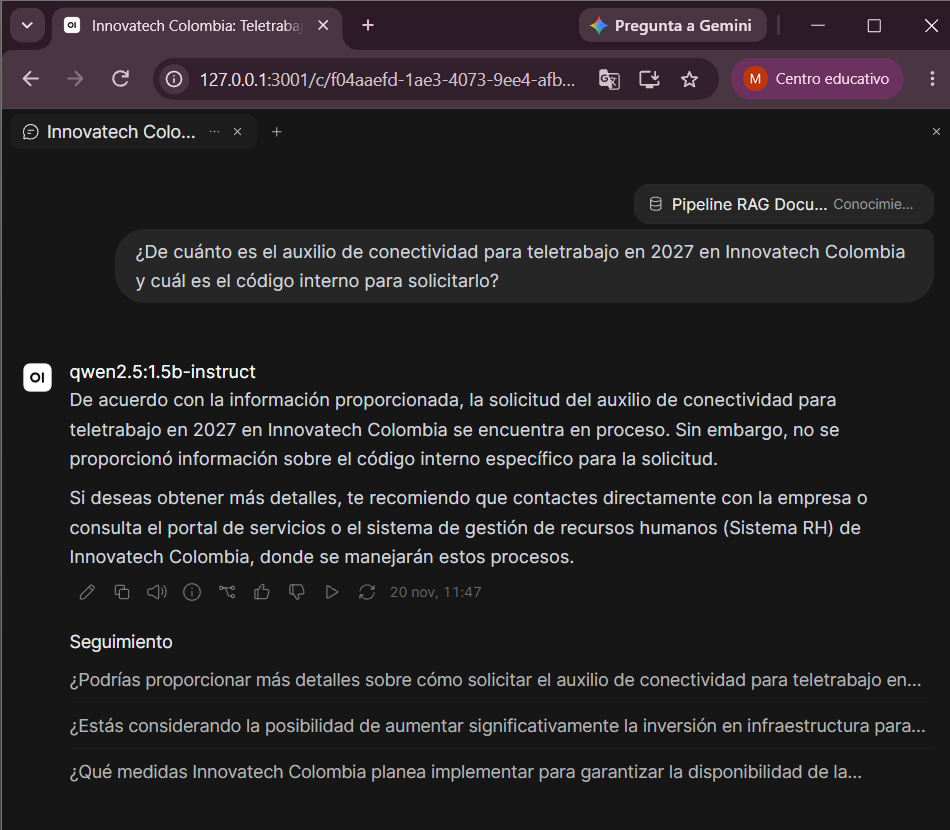
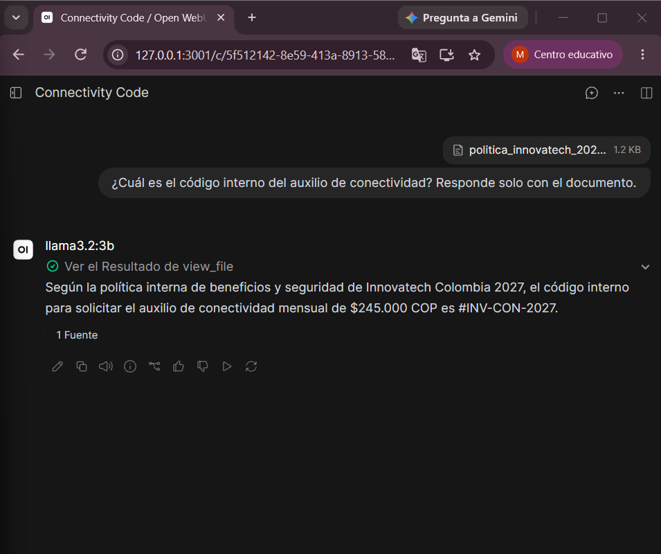
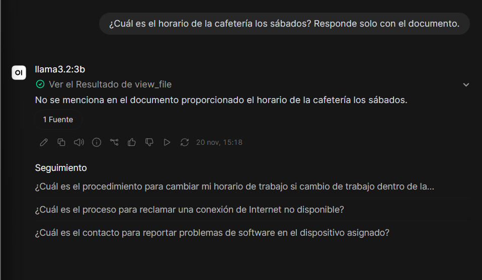

# Informe: Pipeline RAG Documental con Open WebUI y Ollama

- **Autor(es):** [completar]
- **Fecha:** 20/11/2026
- **Proyecto:** `lab3_pipeline_rag_openwebui`

## 1. Objetivo

Montar un pipeline RAG local con Open WebUI y Ollama, y comprobar que el modelo responde con información de un documento propio y no inventa lo que el documento no dice.

## 2. Entorno

| Componente                           | Detalle                                                                     |
| ------------------------------------ | --------------------------------------------------------------------------- |
| Sistema                              | Windows con Docker Desktop                                                  |
| Open WebUI                           | v0.13.4, contenedor `lab3_pipeline_rag_openwebui-open-webui-1`, puerto 3001 |
| Ollama                               | contenedor `lab3_pipeline_rag_openwebui-ollama-1`, puerto 11435             |
| Modelo de embeddings                 | `nomic-embed-text` (motor Ollama, URL `http://ollama:11434`)                |
| Modelos de lenguaje probados         | `qwen2.5:1.5b-instruct`, `qwen2.5:3b-instruct`, `llama3.2:3b`               |
| Modelo usado en las evidencias 2 y 3 | `llama3.2:3b`                                                               |
| Colección                            | `Pipeline RAG Documental`                                                   |

Configuración de Documentos: tamaño de fragmento 1024, solapamiento 100, Top K 10, divisor de texto Character, incrustación y recuperación activas.

## 3. Documento de prueba

`politica_innovatech_2027.txt` (1,2 KB, 23 líneas extraídas). Contiene tres políticas:

1. **Auxilio de conectividad:** $245.000 COP mensuales para colaboradores en modalidad híbrida, desde enero de 2027. Código interno: `#INV-CON-2027`.
2. **Vacaciones anticipadas:** hasta 7 días hábiles para empleados con más de 6 meses y menos de 1 año de vinculación, con aprobación del líder de proyecto y de Recursos Humanos.
3. **Ciberseguridad:** reporte de incidentes en menos de 2 horas por Slack `#sec-incidentes-urgente` o extensión 809; cifrado AES-256 con rotación trimestral de llaves.

## 4. Evidencias

### 4.1 Antes del RAG (`01_antes_del_RAG.png`)

Pregunta sin documento ni colección adjuntos.

- Modelo y respuesta: los que aparecen en la captura.

### 4.2 Después del RAG (`02_despues_del_RAG.png`)

- Modelo: `llama3.2:3b`, con `politica_innovatech_2027.txt` adjunto y la opción **Usar documento completo**.
- Pregunta: «¿Cuál es el código interno del auxilio de conectividad? Responde solo con el documento.»
- Respuesta: indica que el código interno para solicitar el auxilio de conectividad de $245.000 COP es `#INV-CON-2027`, con 1 fuente visible.
- Resultado: coincide con el documento.

### 4.3 Prueba antialucinación (`03_prueba_antialucinacion.png`)

- Pregunta: «¿Cuál es el horario de la cafetería los sábados? Responde solo con el documento.»
- Respuesta: «No se menciona en el documento proporcionado el horario de la cafetería los sábados.»
- Resultado: el modelo no inventó un horario y reconoció que la información no está en el documento.

## 5. Problemas encontrados

Antes de obtener las respuestas correctas hubo varias respuestas incorrectas:

| Síntoma                                                                                                         | Modelo                                         |
| --------------------------------------------------------------------------------------------------------------- | ---------------------------------------------- |
| Respuestas genéricas, «no se encontró información»                                                              | `qwen2.5:1.5b-instruct`                        |
| Código interno inventado (`75781128`, `12345`) que no está en el documento                                      | `qwen2.5:1.5b-instruct`, `qwen2.5:3b-instruct` |
| Llamadas JSON a herramientas inexistentes (`search_calendar_events`, `create_tasks`)                            | `qwen2.5`                                      |
| Llamada a la herramienta integrada `create_tool` en lugar de responder                                          | `llama3.2:3b`                                  |
| Búsqueda literal que no coincidió (`grep_chat_files`) porque la pregunta tenía «auxiliar» en lugar de «auxilio» | `qwen2.5:1.5b-instruct`                        |
| Documento equivocado: se adjuntó el PDF del laboratorio en lugar del `.txt`                                     | `qwen2.5:1.5b-instruct`                        |

También hubo un cuelgue de Open WebUI y de Docker Desktop al cargar varios modelos a la vez junto con los contenedores de un proyecto anterior. Se resolvió con `wsl --shutdown`, reiniciando Docker y deteniendo los contenedores que no se usaban.

## 6. Comprobaciones realizadas

- Open WebUI responde en `http://127.0.0.1:3001/health` con HTTP 200.
- El endpoint de embeddings de Ollama (`/api/embed` con `nomic-embed-text`) respondió HTTP 200 desde fuera de Open WebUI.
- El texto del documento se extrajo correctamente (se vio en la vista previa de Open WebUI).
- Reindexar los vectores no resolvió el problema inicial.

## 7. Ajustes que resolvieron el problema

1. Cambiar de `qwen2.5:1.5b-instruct` a `llama3.2:3b`.
2. Apagar todas las herramientas integradas del modelo `llama3.2:3b` (incluida «Creación de Herramientas») y dejar el modo de llamada a funciones en Predeterminado.
3. Adjuntar el `.txt` correcto con **Usar documento completo**.
4. Liberar memoria deteniendo los contenedores del proyecto anterior.

## 8. Limitaciones

- En las capturas 2 y 3, Open WebUI muestra «Ver el resultado de `view_file`»: el modelo leyó el archivo adjunto con una herramienta de lectura de archivos. Por eso **no se demuestra** recuperación vectorial sobre la colección `Pipeline RAG Documental` (fragmentos y embeddings). Esa prueba no quedó confirmada en este informe.
- Se usó un solo documento de 1,2 KB, así que el resultado no permite concluir sobre colecciones grandes.
- Los modelos de 1,5B y 3B parámetros son sensibles a las herramientas integradas y a cómo está redactada la pregunta.

## 9. Conclusiones

- Con `llama3.2:3b`, las herramientas integradas apagadas y el documento adjunto completo, el modelo respondió con el dato correcto y citó su fuente.
- Ante una pregunta cuya respuesta no está en el documento, el modelo dijo que no figuraba, sin inventar.
- En modelos pequeños, las herramientas integradas de Open WebUI pueden hacer que el modelo emita llamadas en lugar de responder; apagarlas fue decisivo.
- Antes de dar por bueno un RAG hay que contrastar la respuesta con el documento: respuestas como `75781128` sonaban seguras y eran falsas.
